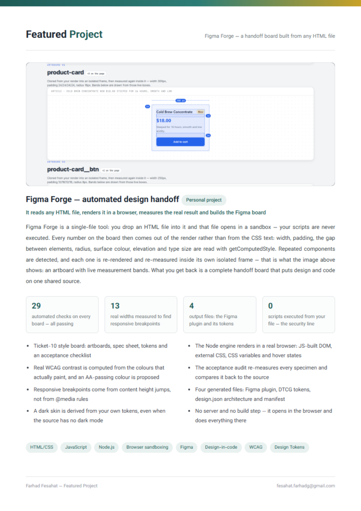

# CV — Farhad Fesahat

Web developer (React, Node.js, WordPress) and financial-markets analyst & trader.

**[CV-Farhad-Fesahat-EN-V2.pdf](./CV-Farhad-Fesahat-EN-V2.pdf)** — three A4 pages: profile and experience, selected work, featured project.

## Featured project — Figma Forge

Page 3 of the CV, exported as an image:

## Sample output of the Figma tooling

[`figma-sample-output/`](./figma-sample-output/) — the files the tool generates from one HTML file: a Figma plugin (`code.js`, `manifest.json`), design tokens (`tokens.json`), the measured architecture (`design.json`), the HTML it measured and the board as a PDF.

Contact: fesahat.farhadg@gmail.com · +98 998 117 1774
